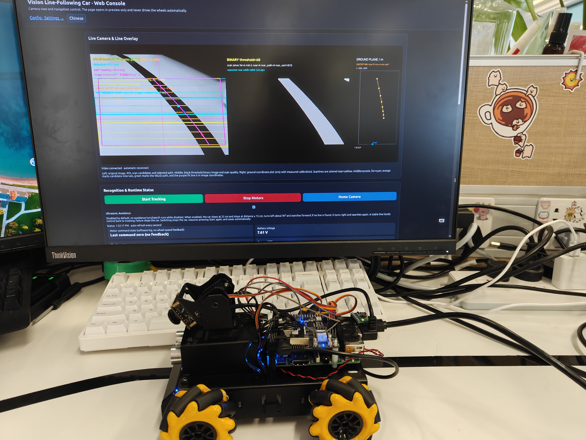
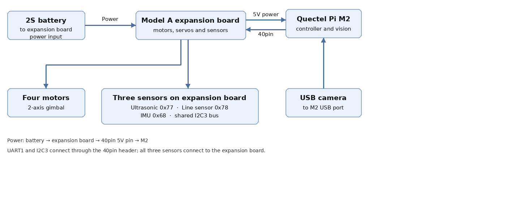
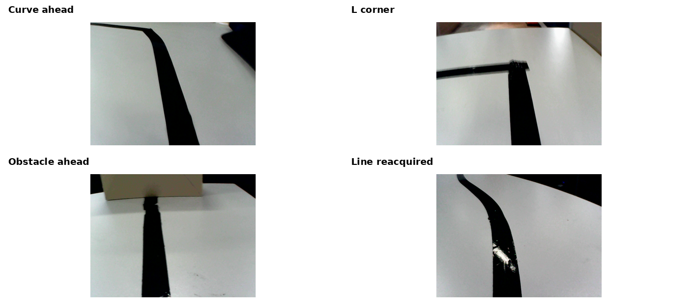

# Vision Line-Following and Ultrasonic Obstacle-Avoidance Car

[English](README.md) | [简体中文](README_zh.md)

[](https://github.com/Quectel-Pi/)

Built on Quectel Pi M2, a Hiwonder mecanum chassis and a USB camera, this demo uses Python and OpenCV to detect 20 mm black tape and follow straight sections, normal curves and consecutive left/right L corners. It supports optional ultrasonic obstacle avoidance with line reacquisition, 60 mm short-T stopping, and browser preview, start/stop and English/Chinese configuration. The page starts in preview only; confirm the camera and runtime status before starting the wheels manually.



**Demo video (English subtitles):**

https://github.com/user-attachments/assets/e35c5721-9a22-4f7a-95f6-db2f5c3f6ac0

---

## Features

- Multi-scanline tape detection with near-line error, heading, curvature and speed control for straight sections, normal curves and left/right L corners.
- Left and right L-corner transitions confirm the exit and continue tracking, with no corner-count limit.
- Ultrasonic avoidance is disabled by default. When enabled, approximately 250 mm slows the car, 150 mm triggers stopping and an in-place left turn, and 60 mm retains near-obstacle hard stopping. During the turn the car first stops to confirm a takeover line, then resumes tracking.
- A 60 mm short-T crossbar requests stopping near the four-wheel geometric centre; short-T alignment takes priority over ultrasonic avoidance.
- Browser preview, start/stop, an avoidance switch and a separate Config page, with English as the default interface language and Chinese switching.

---

## Hardware

| Hardware | Configuration |
| --- | --- |
| Controller | Quectel Pi M2, 4 GB RAM, Debian ARM64 |
| Expansion board | Hiwonder Raspberry Pi 5 expansion board Model A |
| Chassis | Hiwonder mecanum chassis, four DC motors without encoders |
| Camera | USB camera with a two-axis gimbal, fixed during tracking |
| Sensors | I2C ultrasonic 0x77, four-channel line sensor 0x78, MPU6050 0x68 |
| Power | 2S battery to the expansion board, then 5V to M2 through the 40-pin header |
| Track | Light, flat surface with 20 mm black tape; short-T crossbar total length 60 mm |

All items above are required for this demo.

**Hardware connection**

M2 and the expansion board connect through the 40-pin header. All three sensors connect to the expansion board IIC bus, and the camera connects to an M2 USB port. The battery feeds the expansion board, which supplies M2 through the 5V pin on the 40-pin header. See the [wiring guide](docs/接线说明.md) for interfaces, pins and motor order.



---

## Quick Start

Python 3.10 or later is required. Make sure the runtime user can access the USB camera, /dev/ttyS1 and /dev/i2c-3.

```bash
# 1. Get the project code
git clone https://github.com/Quectel-Pi/demo-vision-line-navigation.git
cd demo-vision-line-navigation

# 2. Install system dependencies and add device permissions (re-login required)
sudo apt update
sudo apt install -y git python3 python3-pip python3-venv python3-dev i2c-tools
sudo usermod -aG dialout,video "$USER"

# 3. Create a virtual environment and install project dependencies
python3 -m venv .venv
source .venv/bin/activate
python3 -m pip install --upgrade pip
python3 -m pip install -r requirements.txt

# 4. Run the demo (preview only; the wheels are not armed automatically)
python3 -m line_follow_demo --config config/demo.json --host 0.0.0.0 --port 8081
```

Before the first run, set `camera.device` in `config/demo.json` to the actual camera path, and confirm that `/dev/ttyS1` and `/dev/i2c-3` exist and `i2cdetect -y 3` shows 0x68, 0x77 and 0x78. To install the preview-only background service, run `bash scripts/install_preview_autostart.sh` and `sudo loginctl enable-linger "$USER"` so the service survives logout and boot. To use a direct phone hotspot, install `dnsmasq-base` and `network-manager`, then run `sudo bash scripts/setup_phone_ap.sh`. The default hotspot is `QuectelPiM2` / `pi12345678`, and the page is `http://192.168.4.1:8081/`.

**Run result**

The program listens on `0.0.0.0:8081` and keeps the vehicle in preview. Open `http://<M2-IP>:8081/` on a computer or phone to see the live camera, near/far line status, IMU, forward distance and battery voltage. The interface defaults to English; select `Chinese` to switch. The parameter page is `http://<M2-IP>:8081/config`.



**Usage**

1. Wait until the camera view, IMU READY, distance and four line-sensor channels are normal; place the car on the tape and confirm there is turning space.
2. Select Start Tracking and confirm. The car starts low-speed tracking; Stop Motors stops it immediately.
3. Enable Ultrasonic Avoidance when needed. Short-T stopping is enabled by default and needs no extra action.
4. Changing parameters on `/config` stops the car. Save, return to the main page and start tracking again; saving reacquires the line.
5. Run images, telemetry and diagnostics are written to the sibling `run-data/demo-vision-line-navigation/` directory; download the run after stopping.

**Developer documentation**

- [Wiring guide](docs/接线说明.md)
- [Ground calibration tool](scripts/ground_distance_calibrate.py)
- Main configuration: `config/demo.json` (vision, motors, IMU, L corners, avoidance and short T); `config/ground_distance_calibration.json` (image-to-ground mapping); `config/yaw_rate_feedback.json` (yaw-rate feedback).

---

## Project Structure

```text
demo-vision-line-navigation/
├── assets/                  # README illustrations
├── config/                  # Runtime and calibration configuration
├── docs/                    # Wiring guide
├── line_follow_demo/        # Navigation application and device drivers
├── scripts/                 # Deployment, hotspot and calibration scripts
├── vendor/                  # Model A SDK
├── web/                     # Browser interface
├── requirements.txt         # Python dependencies
├── README.md                # English documentation
├── README_zh.md             # Chinese documentation
└── LICENSE.txt              # Open-source license
```

---

## Reporting Issues

For controller support, visit the [official Quectel Pi forum](https://forumschinese.quectel.com/c/quectel-pi/58). Our support team will help with technical questions. Issues and pull requests are welcome to improve this project.
