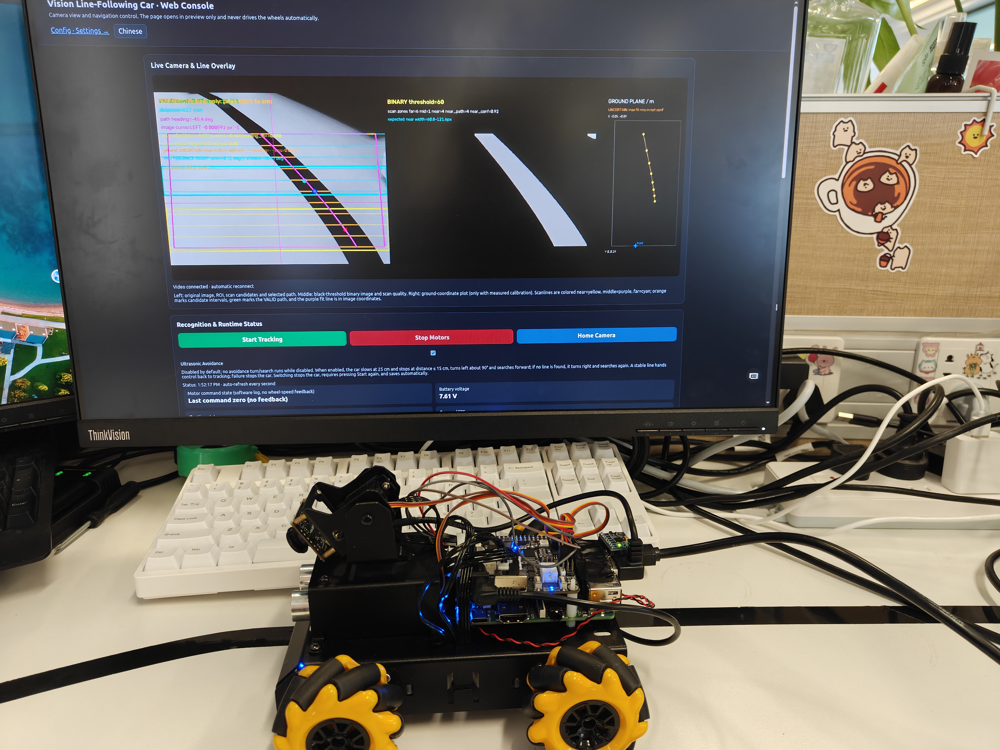
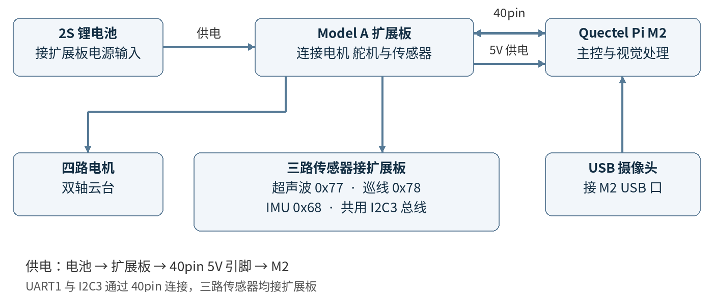
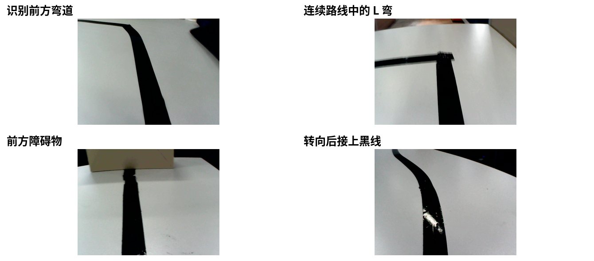

# 视觉循迹与超声波避障小车

[English](README.md) | [简体中文](README_zh.md)

[](https://github.com/Quectel-Pi/)

基于 Quectel Pi M2、幻尔麦轮底盘和 USB 摄像头，使用 Python 与 OpenCV 识别宽 20 mm 的黑色胶带，实现直线、普通弯道和连续左右 L 弯循迹。支持可开关的超声波避障转向寻线、6 cm 短 T 停车，以及网页预览、启停和中英文参数配置。上电后页面先进入预览，确认画面和状态后再手动启动。



**演示视频（英文字幕）：** [点击观看 Demo 视频](assets/demo-vision-follow-avoid-sub-en-720p.mp4)

---

## 功能特性

- 多扫描线识别黑线，结合近端偏差、方向、曲率和速度控制，完成直线、普通弯道和左右 L 弯循迹。
- 左右 L 弯转向后确认出口并继续循迹，不限制过弯次数。
- 超声波避障默认关闭；开启后约 25 cm 减速、15 cm 触发停车和原地左转，6 cm 保留近障硬停，转向中先停稳确认可接管的新线再恢复循迹。
- 6 cm 短 T 横线用于停车，目标为四轮几何中心接近横线；短 T 对位优先于超声波避障。
- 网页实时预览、启停、避障开关和独立 Config 参数页，默认英文界面，可切换中文。

---

## 硬件配置

| 硬件 | 配置 |
| --- | --- |
| 主控 | Quectel Pi M2，4 GB RAM，Debian ARM64 |
| 扩展板 | 幻尔树莓派 5 扩展板 Model A |
| 底盘 | 幻尔麦轮底盘，4 个无编码器直流电机 |
| 摄像头 | USB 摄像头与双轴云台，循迹时固定视角 |
| 传感器 | I2C 超声波 0x77、四路巡线 0x78、MPU6050 0x68 |
| 电源 | 2S 锂电池接扩展板，经 40pin 的 5V 给 M2 供电 |
| 赛道 | 浅色平整底面，20 mm 黑色胶带，短 T 横线总长 60 mm |

以上均为本 Demo 必需硬件。

**硬件连接**

M2 与扩展板通过 40pin 连接；三路传感器接扩展板 IIC，摄像头接 M2 的 USB 口；电池接扩展板电源输入，扩展板经 40pin 的 5V 给 M2 供电。接口、引脚和电机顺序见[接线说明](docs/接线说明.md)。



---

## 快速开始

需要 Python 3.10 或以上版本，并确保运行用户可以访问 USB 摄像头、/dev/ttyS1 和 /dev/i2c-3。

```bash
# 1. 获取项目代码
git clone https://github.com/Quectel-Pi/demo-vision-line-navigation.git
cd demo-vision-line-navigation

# 2. 安装系统依赖并加入设备权限组（重新登录后生效）
sudo apt update
sudo apt install -y git python3 python3-pip python3-venv python3-dev i2c-tools
sudo usermod -aG dialout,video "$USER"

# 3. 创建虚拟环境并安装项目依赖
python3 -m venv .venv
source .venv/bin/activate
python3 -m pip install --upgrade pip
python3 -m pip install -r requirements.txt

# 4. 运行 Demo（仅预览，不会自动驱动车轮）
python3 -m line_follow_demo --config config/demo.json --host 0.0.0.0 --port 8081
```

首次运行前，将 config/demo.json 的 camera.device 改为实际摄像头路径，并确认 /dev/ttyS1、/dev/i2c-3 存在、i2cdetect -y 3 能看到 0x68、0x77、0x78。需要后台预览自启时执行 bash scripts/install_preview_autostart.sh，并用 sudo loginctl enable-linger "$USER" 让服务在未登录时随开机启动；需要手机热点直连时先安装 dnsmasq-base 和 network-manager，再执行 sudo bash scripts/setup_phone_ap.sh。默认热点为 QuectelPiM2 / pi12345678，页面为 http://192.168.4.1:8081/。

**运行结果**

程序启动后监听 0.0.0.0:8081，车辆保持预览。浏览器打开 http://<开发板IP>:8081/ 可看到实时画面、近/远线状态、IMU、前方距离和电池电压；默认英文界面，点击 Chinese 切换中文。参数页为 http://<开发板IP>:8081/config。



**使用说明**

1. 等待相机画面、IMU READY、距离和四路巡线读数正常，把车放在黑线上并确认转向空间。
2. 点击“循迹导航”并确认，车辆开始低速循迹；“停止电机”立即停车。
3. 需要避障时打开“超声波避障”开关；短 T 停车默认开启，无需额外操作。
4. 在 /config 修改参数会先停车，保存后回到主页重新启动导航；保存会重新确认黑线。
5. 运行图像、遥测和诊断日志写入工程同级的 run-data/demo-vision-line-navigation/，停止后可下载本轮记录。

**开发者文档**

- [硬件接线说明](docs/接线说明.md)
- [地面标定工具](scripts/ground_distance_calibrate.py)
- 主要配置：config/demo.json（视觉、电机、IMU、L 弯、避障和短 T）；config/ground_distance_calibration.json（地面映射）；config/yaw_rate_feedback.json（角速度反馈）。
- [Quectel Pi 官方论坛](https://forumschinese.quectel.com/c/quectel-pi/58)

---

## 项目结构

```text
demo-vision-line-navigation/
├── assets/                  # README 配图
├── config/                  # 运行配置与标定文件
├── docs/                    # 接线说明
├── line_follow_demo/        # 导航程序与设备驱动
├── scripts/                 # 部署、热点和标定脚本
├── vendor/                  # Model A SDK
├── web/                     # 网页界面
├── requirements.txt         # Python 依赖
├── README.md                # 英文文档
├── README_zh.md             # 中文文档
└── LICENSE.txt              # 开源许可证
```

---

## 报告问题

如在使用过程中遇到问题，欢迎在[移远官方论坛](https://forumschinese.quectel.com/c/quectel-pi/58) 提交技术咨询，我们的技术支持团队将及时为您解答。 欢迎提交Issue和Pull Request来改进此项目。
