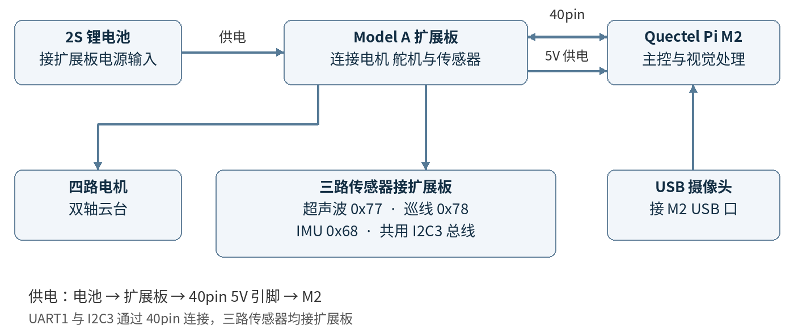

# 硬件接线说明

接线前关闭整车电源。本项目使用 Quectel Pi M2 与幻尔树莓派 5 扩展板 Model A，按当前实车连接：

1. M2 与扩展板通过 40pin 连接。
2. 电池给扩展板供电，扩展板通过 40pin 的 5V 引脚给 M2 供电。
3. 超声波、四路巡线、MPU6050 三路传感器均接扩展板，经 40pin 共用 M2 的 I2C3。
4. USB 摄像头接 M2 USB 口；双轴云台接扩展板舵机通道。

| 设备或信号 | 当前接口 |
| --- | --- |
| 电机与舵机串口 | `/dev/ttyS1`，1000000 baud；40 针物理 8 为 M2 TX、10 为 M2 RX |
| I2C 总线 | `/dev/i2c-3`；40 针物理 3 为 SDA、5 为 SCL |
| 超声波 | 扩展板 IIC 接口，地址 `0x77` |
| 四路巡线 | 扩展板 IIC 接口，地址 `0x78` |
| MPU6050 | 当前扩展板传感器连接，地址 `0x68` |
| 电机映射 | M1 左前、M2 右前、M3 左后、M4 右后 |
| 云台 | PWM 通道 1 水平、2 俯仰 |

编号为 40 针物理位置，不是 GPIO 软件编号。按模块与扩展板丝印确认插头方向。当前安装对左前、左后电机请求取反；更换接线后需重新核对。

四路探头从正常前进方向看由左至右为 Sensor1～Sensor4，间距为 25、14、25 mm；当前探头排在四轮中心前方约 80 mm。所有安装相关标定均以本车为参考。
